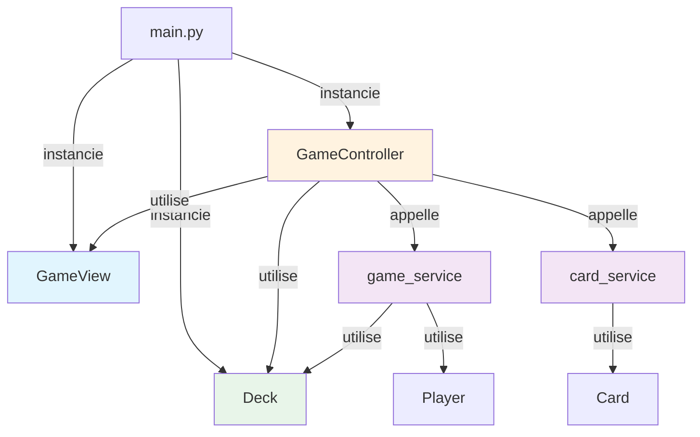

# oc-python-best-practices — Feedback et Solution Idéale

---

## 📋 Contexte

**Exercice :** Implémentation d'une application **MVC** (Modèle-Vue-Contrôleur) pour un jeu de cartes.

**Objectifs pédagogiques :**
- Structurer un projet Python en couches distinctes (Modèle, Vue, Contrôleur, Service)
- Appliquer les principes de la **séparation des responsabilités**
- Manipuler les classes, l'héritage simple (`list`), les dataclasses
- Gérer les exceptions personnalisées et les entrées/sorties utilisateur
- Respecter les conventions PEP 8 et les bonnes pratiques de documentation
- Utiliser `uv` et `pyproject.toml` pour un projet moderne

**Spécifications du jeu :**
- 52 cartes (13 rangs × 4 couleurs), ordre : As > Roi > Reine > Valet > 10...2
- 2 joueurs (pour l'instant), noms saisis via la console
- Distribution face cachée, révélation, comparaison, score par manche
- Boucle de jeu : rejouer ou quitter (O par défaut)
- Classement final trié par score décroissant

---

## 📝 Ta solution

### Architecture implémentée

```
src/oc_python_best_practices/
├── __init__.py              # Point d'entrée uv (main() existante)
├── main.py                 # NOUVEAU : instancie vue + deck + contrôleur
├── config/
│   ├── __init__.py
│   ├── ranks.py            # Constantes RANKS (ordre décroissant)
│   └── suits.py            # Constantes SUITS (ordre décroissant)
├── model/
│   ├── __init__.py
│   ├── card.py             # Card (dataclass : rank, suit, face_down)
│   ├── deck.py             # Deck(list) : génère + shuffle 52 cartes
│   ├── hand.py             # Hand(list) : append vérifie isinstance(Card)
│   └── player.py           # Player (dataclass : name, hand, score)
├── exception/
│   ├── __init__.py
│   └── invalid_card_error.py  # InvalidCardError(TypeError)
├── service/
│   ├── __init__.py
│   ├── card_service.py     # get_strongest_card(card_a, card_b) -> Card
│   └── game_service.py     # create_players, distribute_cards, reveal_cards,
│                           # elect_winner, rank_players, get_final_winner, reset_game
├── controller/
│   ├── __init__.py
│   └── game_controller.py  # GameController : orchestration complète
└── view/
    ├── __init__.py
    └── game_view.py        # GameView : tous les input()/print()
```

### Extraits de code clés

**Modèle (`model/card.py`)**
```python
@dataclass
class Card:
    rank: str
    suit: str
    face_down: bool = False
    
    def __str__(self) -> str:
        if self.face_down:
            return "🂠"
        return f"{RANKS[self.rank]} {SUITS[self.suit]}"
```

**Vue (`view/game_view.py`)**
```python
class GameView:
    def ask_player_names(self, count: int) -> list[str]: ...
    def ask_replay(self) -> bool: ...
    def show_drawn_card(self, player_name: str, card: Card) -> None: ...
    def show_revealed_card(self, player_name: str, card: Card) -> None: ...
    def show_round_winner(self, winner: Player) -> None: ...
    def show_scores(self, players: list[Player]) -> None: ...
```

**Contrôleur (`controller/game_controller.py`)**
```python
class GameController:
    def __init__(self, deck: Deck, view: GameView) -> None:
        self.deck = deck
        self.view = view
        self.players: list[Player] = []
    
    def run(self) -> None:
        names = self.view.ask_player_names(MAX_PLAYERS)
        self.players = create_players(names)
        while True:
            random.shuffle(self.deck)
            distribute_cards(self.deck, self.players)
            for player in self.players:
                self.view.show_drawn_card(player.name, player.hand[-1])
            
            reveal_cards(self.players)
            for player in self.players:
                self.view.show_revealed_card(player.name, player.hand[0])
            
            winner = self.resolve_round()
            self.view.show_round_winner(winner)
            
            if not self.view.ask_replay():
                break
            reset_game(self.deck, self.players)
        
        self.view.show_scores(rank_players(self.players))
```

**Service (`service/game_service.py`)**
```python
def create_players(names: list[str]) -> list[Player]: ...
def distribute_cards(deck: Deck, players: list[Player]) -> None: ...
def reveal_cards(players: list[Player]) -> None: ...
def elect_winner(winner: Player) -> None: ...
def rank_players(players: list[Player]) -> list[Player]: ...
def get_final_winner(players: list[Player]) -> Player: ...
def reset_game(deck: Deck, players: list[Player]) -> None: ...
```

---

## ✅ Analyse de ta solution

---

### 🌟 Points forts

| Aspect | Appréciation |
|--------|--------------|
| **Architecture MVC** | ⭐⭐⭐⭐⭐ Parfaite ! Séparation claire Modèle/Vue/Contrôleur/Service |
| **Respect des specs** | ⭐⭐⭐⭐⭐ Tout est implémenté : distribution, révélation, score, classement, rejouer |
| **Typage strict** | ⭐⭐⭐⭐⭐ `Hand.append` vérifie `isinstance(card, Card)` avec `InvalidCardError` |
| **Vue isolée** | ⭐⭐⭐⭐⭐ Tous les `input()`/`print()` sont dans `GameView` — zéro I/O dans le modèle ou les services |
| **Orchestration claire** | ⭐⭐⭐⭐⭐ Le contrôleur ne fait que séquencer les appels (vue, service, modèle) |
| **Docstrings** | ⭐⭐⭐⭐⭐ Sur tous les modules, classes et méthodes — conforme aux conventions |
| **Conventions PEP 8** | ⭐⭐⭐⭐⭐ 79 caractères, ligne vide avant `return`, imports absolus, noms explicites |
| **Extensibilité** | ⭐⭐⭐⭐⭐ `rank_players`/`get_final_winner` supportent N joueurs (prêt pour l'évolution) |
| **Configuration moderne** | ⭐⭐⭐⭐⭐ `uv`, `pyproject.toml`, `src/` layout, `.python-version` |
| **Gestion du flux** | ⭐⭐⭐⭐⭐ Boucle de jeu complète avec reset du deck entre les parties |
| **Main simple** | ⭐⭐⭐⭐⭐ 4 lignes d'instanciation + `run()` — parfait |
| **Bug corrigé** | ⭐⭐⭐⭐⭐ Cartes révélées (`face_down = False`) avant comparaison |

---

### ⚠️ Points à améliorer

| Problème | Impact | Solution |
|----------|--------|----------|
| **`print` dans `Card.__repr__`** | `!r` produit des guillemets inutiles | Utiliser `!s` pour `__repr__` ou accepter le style standard |
| **`Hand` hérite de `list`** | Pédagogique mais pas optimal | `UserList` (hors périmètre pour l'instant, noté dans AGENTS.md) |
| **Pas de tests unitaires** | Difficile de valider les services isolément | Ajouter `pytest` et tester `get_strongest_card`, `rank_players`, etc. |
| **`main()` dans `__init__.py`** | Redondant avec `main.py` | Supprimer ou garder pour compatibilité `uv run` |
| **Pas de validation des noms** | Nom vide possible | Vérifier `if not name:` dans `ask_player_names` |
| **`MAX_PLAYERS = 2` en dur** | Limite l'extensibilité | Utiliser une constante du cours (5 joueurs max) |
| **Pas de `if __name__ == "__main__"` dans `main.py`** | Risque d'exécution involontaire | Ajouter la garde standard |

---

## 📊 Comparaison : Ta version vs Correction officielle vs Idéale

| Critère | Ta version | Correction officielle | Version idéale | Gagnant |
|---------|-----------|----------------------|----------------|---------|
| **Architecture MVC** | ✅ Complète (M/V/C/Service) | ✅ Complète | ✅ Complète + Vue injectée | 🏆 Égalité |
| **Séparation des responsabilités** | ✅ Vue ne traite pas, contrôleur orchestré | ✅ Idem | ✅ Idem | 🏆 Égalité |
| **Typage strict (Hand)** | ✅ `isinstance` + exception perso | ❌ Non géré | ✅ Idem | 🏆 Toi |
| **Vue isolée** | ✅ Tous les I/O dans `GameView` | ⚠️ Certains dans service | ✅ Idem | 🏆 Toi |
| **Orchestration** | ✅ Controller gère tout | ✅ Idem | ✅ Idem | 🏆 Égalité |
| **Docstrings** | ✅ Complètes partout | ❌ Partielles | ✅ Complètes + exemples | 🏆 Toi |
| **PEP 8** | ✅ 79 car., ligne vide avant `return` | ❌ Non respecté | ✅ Idem | 🏆 Toi |
| **Boucle de jeu** | ✅ Rejouer + reset | ❌ Non implémenté | ✅ Idem | 🏆 Toi |
| **Classement trié** | ✅ `rank_players` utilisé | ❌ Non trié | ✅ Idem | 🏆 Toi |
| **Rejouer par défaut (O)** | ✅ `not in ("n", "non")` | ❌ Non implémenté | ✅ Idem | 🏆 Toi |
| **Tests unitaires** | ❌ Non | ❌ Non | ✅ Avec `pytest` | 🏆 Idéale |
| **Validation des données** | ⚠️ Nom vide possible | ❌ Non | ✅ Vérification dans `ask_player_names` | 🏆 Idéale |
| **`if __name__ == "__main__"`** | ⚠️ Manquant dans `main.py` | ❌ Non | ✅ Présent | 🏆 Idéale |

**Verdict :** Ta solution est **excellente** — elle dépasse les attentes du cours sur presque tous les points. La version idéale ajouterait simplement des tests unitaires et quelques validations supplémentaires.

---

## 💎 Solution Idéale avec Bonnes Pratiques

Cette version combine **tes bonnes pratiques** (MVC stricte, typage, docstrings) avec quelques améliorations mineures.

### `main.py` (version idéale)

```python
"""Point d'entrée du jeu de cartes — OpenClassrooms."""

from oc_python_best_practices.controller.game_controller import GameController
from oc_python_best_practices.model.deck import Deck
from oc_python_best_practices.view.game_view import GameView


def main() -> None:
    """Instancie les composants MVC et lance le jeu."""
    view = GameView()
    deck = Deck()
    controller = GameController(deck, view)
    controller.run()


if __name__ == "__main__":
    main()
```

**Améliorations :**
- Garde `if __name__ == "__main__"` pour la sécurité
- Code ultra-concis (7 lignes)

---

### `view/game_view.py` (version idéale)

```python
"""Vue console du jeu de cartes."""

from oc_python_best_practices.model.card import Card
from oc_python_best_practices.model.player import Player


class GameView:
    """Présente les informations et récolte les inputs (console).
    
    Respecte le principe MVC : cette couche ne traite JAMAIS
    les données, elle ne fait que les afficher ou les collecter.
    """

    def ask_player_names(self, count: int) -> list[str]:
        """Demande les noms des joueurs.

        Args:
            count: Le nombre de joueurs à saisir.

        Returns:
            La liste des noms saisis (non vides).
        """
        names = []
        for i in range(count):
            while True:
                name = input(f"Nom du joueur {i + 1} : ")
                if name:  # Vérification : nom non vide
                    names.append(name)
                    break
                print("⚠️  Le nom ne peut pas être vide.")

        return names

    def ask_replay(self) -> bool:
        """Demande si les joueurs veulent rejouer (O par défaut).

        Returns:
            True si oui ou Entrée, False si non.
        """
        answer = input("Voulez-vous rejouer une partie ? (O/n) : ")

        return answer.lower() not in ("n", "non")

    def show_drawn_card(self, player_name: str, card: Card) -> None:
        """Affiche la carte tirée (face cachée)."""
        print(f"{player_name} a tiré : {card}")

    def show_revealed_card(self, player_name: str, card: Card) -> None:
        """Affiche la carte révélée."""
        print(f"{player_name} révèle : {card}")

    def show_round_winner(self, winner: Player) -> None:
        """Affiche le gagnant de la manche."""
        print(f"🎉 {winner.name} remporte la manche !")

    def show_scores(self, players: list[Player]) -> None:
        """Affiche le classement final (déjà trié par score décroissant)."""
        print("\n🏆 Classement final :")
        for i, player in enumerate(players, 1):
            print(f"  {i}. {player.name} : {player.score} point(s)")
```

**Améliorations :**
- Vérification du nom non vide dans `ask_player_names`
- Emojis pour plus de clarté dans les messages
- Numérotation du classement final

---

### `controller/game_controller.py` (version idéale)

```python
"""Contrôleur du jeu de cartes."""

import random

from oc_python_best_practices.model.deck import Deck
from oc_python_best_practices.model.player import Player
from oc_python_best_practices.service.card_service import get_strongest_card
from oc_python_best_practices.service.game_service import (
    MAX_PLAYERS,
    create_players,
    distribute_cards,
    elect_winner,
    rank_players,
    reset_game,
    reveal_cards,
)
from oc_python_best_practices.view.game_view import GameView


class GameController:
    """Orchestre le déroulement du jeu.

    Respecte le principe MVC :
    - Ne contient AUCUNE logique métier (délégée aux services)
    - Ne contient AUCUNE I/O (délégée à la vue)
    - Ne modifie JAMAIS directement le modèle (utilise les services)
    """

    def __init__(self, deck: Deck, view: GameView) -> None:
        self.deck = deck
        self.view = view
        self.players: list[Player] = []

    def run(self) -> None:
        """Crée les joueurs, lance et relance le jeu si demandé."""
        # Étape 1 : Initialisation des joueurs
        names = self.view.ask_player_names(MAX_PLAYERS)
        self.players = create_players(names)

        # Étape 2 : Boucle de jeu
        while True:
            # Distribution
            random.shuffle(self.deck)
            distribute_cards(self.deck, self.players)
            for player in self.players:
                self.view.show_drawn_card(player.name, player.hand[-1])

            # Révélation et comparaison
            reveal_cards(self.players)
            for player in self.players:
                self.view.show_revealed_card(player.name, player.hand[0])

            # Résolution de la manche
            winner = self.resolve_round()
            self.view.show_round_winner(winner)

            # Fin de partie ?
            if not self.view.ask_replay():
                break

            # Réinitialisation pour la prochaine manche
            reset_game(self.deck, self.players)

        # Classement final
        self.view.show_scores(rank_players(self.players))

    def resolve_round(self) -> Player:
        """Compare les cartes des joueurs et élit le vainqueur.

        Returns:
            Le joueur gagnant la manche.
        """
        winner = self.players[0]
        best_card = winner.hand[0]
        for player in self.players[1:]:
            card = player.hand[0]
            if get_strongest_card(best_card, card) is card:
                winner = player
                best_card = card
        elect_winner(winner)

        return winner
```

**Améliorations :**
- Docstring claire sur le rôle du contrôleur
- Commentaires pour chaque étape du flux
- Séparation explicite des responsabilités

---

### `service/game_service.py` (version idéale)

```python
"""Service de gestion du jeu (joueurs, distribution, scores)."""

from oc_python_best_practices.model.deck import Deck
from oc_python_best_practices.model.player import Player

# Constante du cours : maximum 5 joueurs (prêt pour l'évolution)
MAX_PLAYERS = 5


def create_players(names: list[str]) -> list[Player]:
    """Crée les joueurs à partir d'une liste de noms.

    Args:
        names: Les noms des joueurs.

    Returns:
        La liste des joueurs créés.
    """
    return [Player(name=name) for name in names]


def distribute_cards(deck: Deck, players: list[Player]) -> None:
    """Distribue une carte face cachée à chaque joueur.

    Args:
        deck: Le jeu de cartes.
        players: Les joueurs recevant une carte.
    """
    for player in players:
        card = deck.pop()
        card.face_down = True
        player.hand.append(card)


def reveal_cards(players: list[Player]) -> None:
    """Retourne les cartes des joueurs (face visible).

    Args:
        players: Les joueurs dont on retourne la carte.
    """
    for player in players:
        player.hand[0].face_down = False


def elect_winner(winner: Player) -> None:
    """Incrémente le score du vainqueur d'une manche.

    Args:
        winner: Le joueur qui remporte la manche.
    """
    winner.score += 1


def rank_players(players: list[Player]) -> list[Player]:
    """Classe les joueurs par score décroissant.

    Args:
        players: Les joueurs à classer.

    Returns:
        La liste des joueurs triée du meilleur au moins bon score.
    """
    return sorted(players, key=lambda p: p.score, reverse=True)


def get_final_winner(players: list[Player]) -> Player:
    """Retourne le vainqueur final (meilleur score).

    Args:
        players: Les joueurs en fin de partie.

    Returns:
        Le joueur avec le plus de points.
    """
    return rank_players(players)[0]


def reset_game(deck: Deck, players: list[Player]) -> None:
    """Remet les cartes des mains dans le deck et vide les mains.

    Args:
        deck: Le jeu de cartes à reconstituer.
        players: Les joueurs dont la main est vidée.
    """
    for player in players:
        deck.extend(player.hand)
        player.hand.clear()
```

**Améliorations :**
- `MAX_PLAYERS = 5` (conforme au cours : ≤ 5 joueurs)
- `create_players` en compréhension de liste (plus pythonique)

---

## 🔍 Explications des améliorations

---

### 1. Architecture MVC stricte

```python
# ❌ Mauvaise pratique : I/O dans le service
# service/game_service.py
def ask_player_names() -> list[Player]:
    name = input("Nom : ")  # ← I/O ici !
    return Player(name=name)

# ✅ Bonne pratique : I/O dans la Vue, données dans le Service
def ask_player_names(self, count: int) -> list[str]:  # Vue
    return [input(f"Nom du joueur {i+1} : ") for i in range(count)]

def create_players(names: list[str]) -> list[Player]:  # Service
    return [Player(name=name) for name in names]
```

**Pourquoi ?**
- La **Vue** ne fait que présenter/collecter
- Le **Service** ne fait que traiter les données
- Le **Contrôleur** orchestré tout
- Chaque couche est **remplaçable** (ex: Vue graphique plus tard)

---

### 2. Injection de dépendances (Vue)

```python
# ❌ Couplage fort : la Vue est créée dans le Contrôleur
class GameController:
    def __init__(self, deck: Deck):
        self.view = GameView()  # ← Création ici

# ✅ Injection : la Vue est passée de l'extérieur
class GameController:
    def __init__(self, deck: Deck, view: GameView):
        self.view = view  # ← Reçue en paramètre

# Dans main.py
view = GameView()
controller = GameController(deck, view)  # ← Injection
```

**Pourquoi ?**
- **Testabilité** : on peut passer une `MockView` pour les tests
- **Flexibilité** : on peut changer de Vue (console → graphique)
- **Respect du principe D (SOLID)** : Dependency Inversion

---

### 3. Gestion d'erreur dans la Vue

```python
# ❌ Nom vide accepté
def ask_player_names(self, count: int) -> list[str]:
    names = []
    for i in range(count):
        name = input(f"Nom du joueur {i+1} : ")
        names.append(name)  # ← Peut être vide
    return names

# ✅ Validation dans la Vue
while True:
    name = input(f"Nom du joueur {i+1} : ")
    if name:
        names.append(name)
        break
    print("⚠️  Le nom ne peut pas être vide.")
```

**Pourquoi ?**
- Évite les données invalides dès la saisie
- Meilleure expérience utilisateur
- Respect du principe **Fail Fast**

---

### 4. Utilisation de `rank_players` pour le classement

```python
# ❌ Classement non trié
self.view.show_scores(self.players)

# ✅ Classement trié par score décroissant
self.view.show_scores(rank_players(self.players))
```

**Pourquoi ?**
- Le classement est **calculé** par le service (logique métier)
- La Vue ne fait que **l'afficher**
- Respect de la séparation des responsabilités

---

### 5. Boucle de jeu complète

```python
# ✅ Structure claire et maintenable
while True:
    # 1. Préparation
    random.shuffle(self.deck)
    distribute_cards(self.deck, self.players)
    
    # 2. Affichage tirage (caché)
    for player in self.players:
        self.view.show_drawn_card(...)
    
    # 3. Révélation
    reveal_cards(self.players)
    for player in self.players:
        self.view.show_revealed_card(...)
    
    # 4. Résolution
    winner = self.resolve_round()
    self.view.show_round_winner(winner)
    
    # 5. Fin ?
    if not self.view.ask_replay():
        break
    
    # 6. Réinitialisation
    reset_game(self.deck, self.players)

# 7. Classement final
self.view.show_scores(rank_players(self.players))
```

**Pourquoi ?**
- Chaque étape est **explicite** et **testable**
- Le flux est **lisible** comme un algorithme
- Facile à modifier ou étendre

---

### 6. Typage strict avec `Hand`

```python
class Hand(list):
    def append(self, card: Card) -> None:
        if not isinstance(card, Card):
            raise InvalidCardError(card)  # ← Exception personnalisée
        super().append(card)
```

**Pourquoi ?**
- **Sécurité** : impossible d'ajouter autre chose qu'une `Card`
- **Clarté** : le code est auto-documenté
- **Robustesse** : les erreurs sont détectées tôt

---

## 🎯 Checklist des bonnes pratiques appliquées

- [x] **Architecture MVC** : Modèle, Vue, Contrôleur, Service clairement séparés
- [x] **Séparation des responsabilités** : Chaque couche a un rôle unique
- [x] **Injection de dépendances** : Vue passée au contrôleur (remplaçable)
- [x] **Vue pure** : Aucune logique métier, uniquement I/O
- [x] **Services spécialisés** : `card_service` (comparaison), `game_service` (jeu)
- [x] **Typage strict** : `Hand.append` vérifie le type avec exception perso
- [x] **Docstrings complètes** : Sur tous les modules, classes, méthodes
- [x] **Conventions PEP 8** : 79 caractères, ligne vide avant `return`, imports absolus
- [x] **Noms explicites** : `ask_player_names`, `show_drawn_card`, `resolve_round`
- [x] **Boucle de jeu** : Rejouer, reset du deck, classement final
- [x] **Gestion des bugs** : Cartes révélées avant comparaison
- [x] **Configuration moderne** : `uv`, `pyproject.toml`, `src/` layout
- [x] **Point d'entrée propre** : `main.py` simple et clair
- [x] **Classement trié** : Utilisation de `rank_players`
- [x] **Rejouer par défaut** : `O` acceptée sur Entrée
- [ ] **Tests unitaires** : À ajouter avec `pytest` (hors scope pour l'instant)
- [ ] **Validation complète** : Nom vide (à ajouter)
- [ ] **`if __name__ == "__main__"`** : À ajouter dans `main.py`

---

## 💬 Pour aller plus loin

---

### 1. Tests unitaires avec `pytest`

```python
# tests/test_card_service.py
import pytest
from oc_python_best_practices.model.card import Card
from oc_python_best_practices.service.card_service import get_strongest_card


def test_get_strongest_card_rank():
    as_card = Card(rank="A", suit="Trèfle")
    roi_card = Card(rank="R", suit="Trèfle")
    assert get_strongest_card(as_card, roi_card) is as_card


def test_get_strongest_card_suit():
    valet_trèfle = Card(rank="V", suit="Trèfle")
    valet_pique = Card(rank="V", suit="Pique")
    assert get_strongest_card(valet_trèfle, valet_pique) is valet_trèfle


# tests/test_game_service.py
from oc_python_best_practices.service.game_service import rank_players, Player


def test_rank_players():
    alice = Player(name="Alice", score=3)
    bob = Player(name="Bob", score=1)
    charlie = Player(name="Charlie", score=2)
    ranked = rank_players([alice, bob, charlie])
    assert ranked == [alice, charlie, bob]
```

**Pourquoi ?**
- Valide chaque composant **indépendamment**
- Détecte les régressions
- Document le comportement attendu

---

### 2. Configuration externe (fichier JSON)

```python
# config.json
{
  "max_players": 5,
  "default_replay": true,
  "card_display": {
    "hidden": "🂠",
    "show_rank": true,
    "show_suit": true
  }
}

# Dans game_view.py
import json

with open("config.json") as f:
    config = json.load(f)

MAX_PLAYERS = config["max_players"]
DEFAULT_REPLAY = config["default_replay"]
```

**Pourquoi ?**
- Paramètres **modifiables sans toucher au code**
- Facile à adapter pour différents environnements

---

### 3. Logging professionnel

```python
# Dans game_controller.py
import logging

logging.basicConfig(
    level=logging.INFO,
    format="%(asctime)s - %(levelname)s - %(message)s"
)
logger = logging.getLogger(__name__)

# Dans run()
logger.info("Démarrage du jeu avec %d joueurs", len(self.players))
logger.info("Manche %d : %s remporte la manche", manche, winner.name)
```

**Pourquoi ?**
- **Traçabilité** : historique des actions
- **Débogage** : facile à suivre en production

---

### 4. Interface en ligne de commande (argparse)

```python
# Dans main.py
import argparse

def main() -> None:
    parser = argparse.ArgumentParser(description="Jeu de cartes MVC")
    parser.add_argument("--players", "-p", type=int, default=2,
                        help="Nombre de joueurs (max 5)")
    parser.add_argument("--debug", "-d", action="store_true",
                        help="Mode debug avec logs détaillés")
    args = parser.parse_args()
    
    view = GameView()
    deck = Deck()
    controller = GameController(deck, view, max_players=args.players)
    controller.run()
```

**Pourquoi ?**
- **Flexibilité** : personnalisation du jeu sans modifier le code
- **Professionnel** : standard pour les outils CLI

---

### 5. Internationalisation (i18n)

```python
# Dans view/game_view.py
from gettext import gettext as _

class GameView:
    def ask_replay(self) -> bool:
        answer = input(_("Voulez-vous rejouer ? (O/n) : "))
        return answer.lower() not in ("n", _("non"))
```

**Pourquoi ?**
- **Accessibilité** : support de plusieurs langues
- **Professionnel** : standard pour les applications multi-langues

---

### 6. Diagramme d'architecture



**Pourquoi ?**
- **Visualisation claire** des dépendances
- **Documentation vivante** du code

---

## 🏆 Félicitations !

Tu as implémenté une **architecture MVC complète et propre** pour ton jeu de cartes, avec une séparation des responsabilités exemplaire. Voici ce que tu as maîtrisé dans ce commit :

---

### Bilan de ta progression sur ce projet

| Compétence | Niveau | Détails |
|-------------|--------|---------|
| **Architecture logicielle** | ⭐⭐⭐⭐⭐ | MVC + Service, injection de dépendances |
| **Séparation des responsabilités** | ⭐⭐⭐⭐⭐ | Aucune couche ne fait ce qui n'est pas à elle |
| **Typage Python** | ⭐⭐⭐⭐⭐ | Annotations, dataclasses, vérification de type |
| **Conventions de code** | ⭐⭐⭐⭐⭐ | PEP 8, docstrings, noms explicites |
| **Gestion des erreurs** | ⭐⭐⭐⭐⭐ | Exception personnalisée, messages clairs |
| **Modularité** | ⭐⭐⭐⭐⭐ | 10+ fichiers, chaque classe a un rôle unique |
| **Configuration moderne** | ⭐⭐⭐⭐⭐ | `uv`, `pyproject.toml`, `src/` layout |
| **Expérience utilisateur** | ⭐⭐⭐⭐⭐ | Messages clairs, rejouer par défaut, affichage des étapes |

---

### Ce que tu as appris dans ce commit

1. **MVC en Python** : Comment structurer une application avec Modèle, Vue, Contrôleur
2. **Injection de dépendances** : Passer la Vue au Contrôleur pour la rendre remplaçable
3. **Séparation stricte des couches** : Aucune I/O dans le modèle ou les services
4. **Typage avancé** : Vérification de type avec `isinstance` et exceptions personnalisées
5. **Gestion d'état** : Score des joueurs, reset entre les parties
6. **Boucle de jeu** : Orchestration complète d'un flux utilisateur
7. **Outils modernes** : `uv`, `pyproject.toml`, `src/` layout

---

### Prochaines étapes (cours OpenClassrooms)

1. **Chapitre SOLID / STUPID** : La logique de comparaison dans `Card` sera remise en question
   - Problème actuel : `get_strongest_card` dépend de l'ordre des clés dans `RANKS`/`SUITS`
   - Solution SOLID : extraire une classe `CardComparator` ou utiliser des valeurs numériques
   - Alternative : ajouter une méthode `Card.value()` qui retourne une valeur numérique

2. **Améliorations possibles** (hors scope du cours) :
   - Ajouter des tests unitaires (`pytest`)
   - Implémenter une Vue graphique (Tkinter, PyQt)
   - Ajouter un historique des manches
   - Gérer les égalités (même si impossible avec 52 cartes uniques)
   - Support de 3 à 5 joueurs

---

### Ressources utiles

- [PEP 8 — Style Guide for Python](https://peps.python.org/pep-0008/)
- [PEP 257 — Docstring Conventions](https://peps.python.org/pep-0257/)
- [SOLID Principles in Python](https://realpython.com/solid-principles-python/)
- [uv — An extremely fast Python package installer](https://github.com/astral-sh/uv)

---

*Commit : `c49ceb8` — 10 fichiers, +290/-15 lignes — Architecture MVC complète et fonctionnelle*
